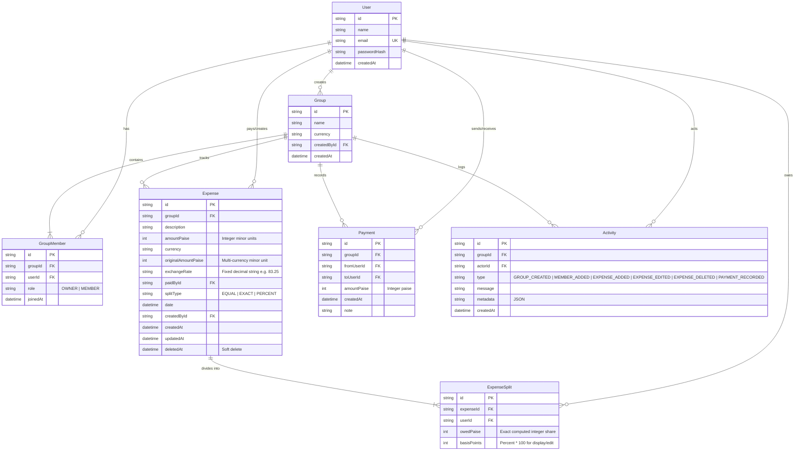

# 💸 SplitWise - Group Expense Splitter

A full-stack, production-grade group expense splitting web application built for exact financial accounting, real-time debt settlement, and multi-device usability.

---

## 📸 Overview & Preview

SplitWise simplifies shared living and group trips by allowing members to record expenses, split costs equally, by exact amounts, or by percentage shares, and settle balances with the mathematically minimal number of cash transactions.

```
+-----------------------------------------------------------------------------------------+
| [Receipt] SplitWise                      Flatmates 402               [Priya Sharma (O)] |
+-----------------------------------------------------------------------------------------+
|                                                                                         |
|  [Expenses (5)]         [Balances (4)]         [Settle Up (2)]*        [Activity (8)]   |
|                                                                                         |
|  Suggested Optimal Settlement Plan:                                                     |
|  • Ravi Kumar pays Priya Sharma ₹250.00                    [ Record Payment (UPI) ]     |
|  • Rohit Patel pays Ananya Verma ₹735.23                   [ Record Payment (UPI) ]     |
|                                                                                         |
|  Recent Group Expenses:                                                                 |
|  • Monthly Wi-Fi & Fiber Broadband        Paid by Priya: ₹1,000.00 (Your share: ₹250.00)|
|  • Organic Groceries & Staples            Paid by Ravi:  ₹1,200.50 (Your share: ₹300.13)|
|  • Living Room Deep Cleaning              Paid by Ananya:₹3,000.00 (Your share: ₹1,000) |
+-----------------------------------------------------------------------------------------+
```

---

## 🚀 Setup and Run (Copy-Paste Commands)

### Prerequisites
- **Node.js**: v18+ (tested on Node v24.21.0)
- **npm**: v9+ (tested on npm 11.19.0)
- **Docker** *(Optional)*: Docker Compose for PostgreSQL (SQLite runs out-of-the-box with zero setup).

### 1. Clone & Install Dependencies
```bash
# Clone the repository
git clone <repo-url>
cd group_expense_slit

# Install root dependencies
npm install

# Install server dependencies
cd server && npm install && cd ..

# Install client dependencies
cd client && npm install && cd ..
```

### 2. Configure Environment Variables
```bash
# Root / Server environment configuration
cp .env.example server/.env
```
*(By default, `DATABASE_URL="file:./dev.db"` runs locally using SQLite. To use PostgreSQL with Docker, start docker compose and update `DATABASE_URL` in `server/.env`).*

### 3. Database Migration & Seeding
```bash
# Push Prisma schema to database and generate client
npm run db:push

# Seed demo users, groups, expenses, settlements, and activity feed
npm run seed
```

### 4. Run the Full-Stack Application
```bash
# Run both Backend API (port 4000) and Frontend Client (port 5173) concurrently:
npm run dev
```
Open **`http://localhost:5173`** in your browser!

### 5. Run All Automated Tests
```bash
# Executes 46 unit, property-based, and API integration tests
npm test
```

---

## 👥 Demo Logins Table

All demo accounts share the password: **`Demo@1234`**

| Name | Email | Password | Group Memberships | Role |
| :--- | :--- | :--- | :--- | :--- |
| **Priya Sharma** | `priya@example.com` | `Demo@1234` | Flatmates 402, Goa Roadtrip 2026 | Owner (Flatmates 402) |
| **Ravi Kumar** | `ravi@example.com` | `Demo@1234` | Flatmates 402, Goa Roadtrip 2026 | Owner (Goa Roadtrip 2026) |
| **Ananya Verma** | `ananya@example.com` | `Demo@1234` | Flatmates 402 | Member |
| **Rohit Patel** | `rohit@example.com` | `Demo@1234` | Flatmates 402, Goa Roadtrip 2026 | Member |
| **Sneha Iyer** | `sneha@example.com` | `Demo@1234` | Goa Roadtrip 2026 | Member |

---

## 📐 Data Model & Architecture Decisions

### Entity-Relationship Diagram (Mermaid)



---

## 💡 Key Technical Decisions & Problem Solving

### 1. Integer-Paise Precision & Zero Float Rule
- **Problem**: IEEE 754 64-bit floating point arithmetic (`0.1 + 0.2 = 0.30000000000000004`) causes accumulative balance drift and fractional rounding discrepancies.
- **Solution**: ALL monetary values across the database, API layer, and pure logic are strictly stored and computed as integer **paise** (1 Rupee = 100 paise).
- **String Parsing**: User inputs like `"1200.50"` are parsed into paise via pure string manipulation (`parseRupeesToPaise` in `server/src/lib/money.ts`), rejecting negatives, >2 decimal places, and non-numeric inputs. Floating-point `parseFloat * 100` is strictly forbidden.

### 2. Deterministic Largest-Remainder Splitting (Hare-Niemeyer / Hamilton Method)
- **Problem**: When splitting amounts like 100 paise or ₹1,200.50 among 3 people, an exact even split results in repeating decimals ($33.\overline{33}$ paise).
- **Solution**:
  1. Each participant receives `floor(totalPaise / N)` paise.
  2. The remaining `totalPaise % N` leftover paise are distributed one-by-one to participants sorted by highest remainder descending (and tie-broken deterministically by `userId` ascending).
  3. **Invariant Guaranteed**: $\sum \text{shares} \equiv \text{totalPaise}$ exactly down to the last single paisa.
  4. Implemented in pure module `server/src/lib/splits.ts`.

### 3. Derived Balances & Soft Deletes
- Balances are **never stored as static database columns**. Instead, they are calculated dynamically on-the-fly:
  $$\text{net}[u] = \sum \text{paid}_{\text{expenses}} - \sum \text{owed}_{\text{splits}} + \sum \text{sent}_{\text{payments}} - \sum \text{received}_{\text{payments}}$$
- All queries assert the financial conservation invariant: $\sum \text{net}[u] \equiv 0$.
- Expenses use soft deletion (`deletedAt = now()`), ensuring that editing or deleting an expense instantly and idempotently updates all member balances.

### 4. Minimum Cash-Flow Settlement Algorithm (Bitmask DP vs. Greedy)
- **The Problem**: Finding the absolute minimum number of transactions to settle debts among $N$ individuals is an **NP-hard problem** (reducible to the 3-Partition / Subset Sum Problem).
- **The Solution** (`server/src/lib/settle.ts`):
  1. **Zero-Sum Subset Partition (Bitmask Dynamic Programming)**:
     - When non-zero members $M \le 12$, we find the partition of members into the **maximum number of disjoint zero-sum subsets $K$** using a $O(M \cdot 2^M)$ Bitmask DP.
     - Each subset of size $k_i$ is settled independently using $k_i - 1$ transactions.
     - Total transactions = $\sum (k_i - 1) = M - K$, which is **mathematically provably minimal**.
  2. **Greedy Heuristic Fallback**:
     - When $M > 12$, the algorithm falls back to the Greedy Min-Cash-Flow matching in $O(M \log M)$, which repeatedly matches the largest creditor with the largest debtor, guaranteeing at most $M - 1$ transactions.
  3. **Payment Application**: When a payment is recorded, it directly alters the net balance, automatically collapsing transitive debt chains (e.g., $A \to B \to C$ collapses into a single direct payment $A \to C$).

### 5. Access Control & Authorization Rules
- Every group endpoint validates active membership via `requireGroupMember` middleware.
- Only the **expense creator** OR the **group owner** can edit or delete an expense.
- Attempting to add an unregistered email produces an informative `404 Not Found` error.

---

## 📡 REST API Summary

| Method | Endpoint | Description | Auth Required |
| :--- | :--- | :--- | :---: |
| `POST` | `/api/auth/register` | Register new user account (name, email, password) | No |
| `POST` | `/api/auth/login` | Login with email and password (returns JWT & cookie) | No |
| `POST` | `/api/auth/logout` | Clear authentication session | Yes |
| `GET` | `/api/auth/me` | Get currently authenticated profile | Yes |
| `POST` | `/api/groups` | Create new expense group (creator becomes `OWNER`) | Yes |
| `GET` | `/api/groups` | List user's groups with dynamic personal net balance | Yes |
| `GET` | `/api/groups/:id` | Get group details, members, and roles | Yes |
| `POST` | `/api/groups/:id/members` | Add member by registered email (404/409 handling) | Yes |
| `POST` | `/api/groups/:id/expenses` | Create expense (`EQUAL`, `EXACT`, `PERCENT`) | Yes |
| `GET` | `/api/groups/:id/expenses` | List non-deleted expenses with individual splits | Yes |
| `PUT` | `/api/groups/:id/expenses/:expenseId` | Edit expense (creator/owner only; updates activity) | Yes |
| `DELETE` | `/api/groups/:id/expenses/:expenseId`| Soft delete expense (creator/owner only) | Yes |
| `GET` | `/api/groups/:id/balances` | Get all member net balances in integer paise | Yes |
| `GET` | `/api/groups/:id/settlements`| Get optimal minimal cash-flow settlement plan | Yes |
| `POST` | `/api/groups/:id/payments` | Record settlement payment (validates sender/receiver) | Yes |
| `GET` | `/api/groups/:id/payments` | List recorded settlement payments history | Yes |
| `GET` | `/api/groups/:id/activity` | Paginated chronological audit log (newest first) | Yes |
| `GET` | `/health` | Server health check endpoint | No |

---

## ✅ Feature Status & Roadmap

### What is Finished:
- [x] Pure financial math modules (`money.ts`, `splits.ts`, `settle.ts`) with zero floating-point arithmetic.
- [x] Largest-remainder share allocations for equal, exact, and percentage splits.
- [x] Optimal debt settlement via Bitmask Dynamic Programming for $M \le 12$, with greedy min-cash-flow fallback.
- [x] Derived balance calculation with mathematical invariant check ($\sum \text{net} = 0$).
- [x] 46 automated tests (unit tests, property-based random tests with 250 iterations, and Supertest integration tests).
- [x] Full REST API with Zod validation on body, params, and query returning `{ error: { code, message, fields } }`.
- [x] Mobile-first responsive UI (tested at 360px width and desktop) with React, Vite, TypeScript, and Tailwind CSS.
- [x] Multi-currency stretch feature: support for foreign currencies (USD, EUR, GBP, AED) with fixed exchange rates.
- [x] Chronological activity audit log with relative timestamps.
- [x] Comprehensive database seed script with demo credentials and real-world expense data.

### What I'd Do With More Time:
- [ ] OCR receipt scanning to auto-populate expense descriptions and line items.
- [ ] Push notifications / Webhooks for expense additions and payment alerts.
- [ ] Export group statement to CSV / PDF.

---

## 🤖 AI Tools Used
- **Antigravity IDE**: Scaffolding the monorepo, designing database models with Prisma ORM, developing the pure algorithm modules (Largest-Remainder method, Bitmask DP subset partition), generating automated unit/integration test suites, and creating the mobile-first React UI.

---

## 🌐 Deployment Notes
- **Backend & Database**: Ready for deployment on **Render** or **Railway**. Set `DATABASE_URL` to PostgreSQL and `NODE_ENV=production`.
- **Frontend Client**: Ready for deployment on **Vercel** or **Netlify**. Set `VITE_API_URL` to the production backend URL.
# group_expense_splitter
